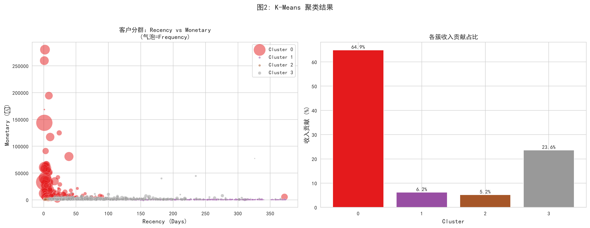
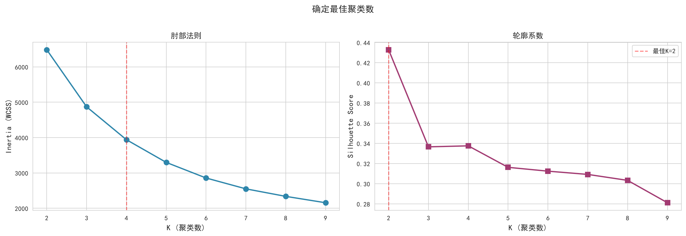

#💎 RFM + CLV 用户价值分层与精准营销

[](https://www.python.org/)
[](https://scikit-learn.org/)
[](https://www.pymc-marketing.io/)
[](LICENSE)

> 基于 UCI Online Retail 约 40 万条交易数据，通过 RFM 特征构建 + K-Means 聚类划分客群，结合 Gamma-Gamma 模型估算 CLV，输出分层营销预算分配方案。

---

## 📊 项目概览

对英国在线零售商的 2010–2011 年交易数据进行客户价值分析。项目超越简单的 RFM 四象限分层，使用 **K-Means 聚类**自动发现客群结构，并用 **CLV 模型**量化每个客群的长期价值，最终输出可直接落地的差异化营销策略。

## ❓ 回答的核心问题

| 序号 | 业务问题 | 分析方法 |
|------|---------|---------|
| 1 | 哪些客户贡献了大部分收入？ | RFM + 帕累托分析 |
| 2 | 客群结构是怎样的？有几类客户？ | K-Means 聚类 |
| 3 | 每类客户的长期价值是多少？ | Gamma-Gamma CLV 模型 |
| 4 | 营销预算应该怎么分配？ | 客群 × 收入占比映射 |
| 5 | 流失风险客户值得召回吗？ | CLV vs 召回成本对比 |

## 🔍 核心发现

1. **收入高度集中**：约 16% 的高价值活跃客户贡献了 65% 的收入，帕累托效应显著
2. **复购率结构不均**：整体复购率约 65%（批发型客户为主），但大量客户仅购买 1–2 次，首购到二购是留存瓶颈
3. **CLV 分布严重右偏**：中位数远低于均值，头部客户 CLV 是普通客户的 10 倍以上
4. **预算错配风险**：按客户数平均分配预算，会让 30% 的低价值客户挤占高价值客户的维护资源
5. **聚类优于人工分层**：K-Means 自动识别出的客群边界，比四分位 RFM 打分更贴合实际收入结构

## 🛠 技术栈

- **数据清洗**：Pandas（缺失值、退货、取消订单、去重）
- **特征工程**：RFM 构建、`log1p` 对数变换、StandardScaler 标准化
- **聚类**：Scikit-learn KMeans、肘部法则、Silhouette Score
- **CLV 建模**：PyMC-Marketing GammaGammaModel
- **可视化**：Matplotlib、Seaborn

## 📁 项目结构

```
Project6-RFM-CLV/
├── README.md
├── requirements.txt
├── data/
│   └── Online_Retail.xlsx
├── notebooks/
│   └── rfm_clv_analysis.ipynb      # 完整分析过程
├── images/
│   ├── rfm_distribution.png        # RFM 分布
│   ├── kmeans_k_selection.png      # 肘部法则 + 轮廓系数
│   ├── kmeans_clusters.png         # 聚类结果散点图
│   └── segment_profile.png         # 客群画像对比
└── report/
    └── analysis_report.md          # 书面分析报告
```

## 🚀 快速复现

```bash
# 1. 克隆仓库
git clone https://github.com/你的用户名/rfm-clv-customer-segmentation.git
cd rfm-clv-customer-segmentation

# 2. 安装依赖
pip install -r requirements.txt

# 3. 下载数据
# 从 UCI Machine Learning Repository 搜索 "Online Retail"
# 下载 Online Retail.xlsx 并转为 CSV，放入 data/ 文件夹
# 或直接用 Kaggle 镜像版 Online_Retail.csv

# 4. 启动 Jupyter
jupyter notebook notebooks/rfm_clv_analysis.ipynb
```

## 📈 关键可视化

### 聚类结果：Recency vs Monetary

> 气泡大小代表购买频率。高价值活跃客户集中在左上角（近期购买、高消费），流失风险客户散布在右侧。

### 最佳聚类数选择

> 肘部法则与轮廓系数共同指向 K=4，兼顾聚类质量与业务可解释性。

## ⚠️ 方法论说明

1. **F 必须按发票号去重**：若按明细行计数，一次批量采购会被误算为多次购买，严重扭曲分群
2. **聚类前必须做 log 变换**：Frequency 和 Monetary 偏度 > 5，不处理会导致少数批发客户主导全部聚类
3. **Gamma-Gamma 前提**：Monetary 与 Frequency 的 Pearson 相关系数需 < 0.3，否则模型假设不成立，应改用启发式公式并注明
4. **数据集属性**：UCI Online Retail 为批发型 B2B 数据，复购率与客单价量级不能直接套用 2C 电商场景

## 📝 关键代码示例

### RFM 构建
```python
rfm = df.groupby('CustomerID').agg(
    Recency=('InvoiceDate', lambda x: (reference_date - x.max()).days),
    Frequency=('InvoiceNo', 'nunique'),
    Monetary=('TotalAmount', 'sum')
).reset_index()
```

### 对数变换 + 标准化
```python
rfm_scaled = StandardScaler().fit_transform(
    np.log1p(rfm[['Recency', 'Frequency', 'Monetary']])
)
```

### K-Means 聚类
```python
kmeans = KMeans(n_clusters=4, random_state=42, n_init=10)
rfm['Cluster'] = kmeans.fit_predict(rfm_scaled)
```

## 🔗 相关链接

- 数据来源：[UCI Machine Learning Repository - Online Retail](https://archive.ics.uci.edu/ml/datasets/Online+Retail)
- 参考方法：K-Means 客户分群、Gamma-Gamma CLV 模型

---
⭐ 如果这个项目对你有帮助，欢迎给个 Star！
```